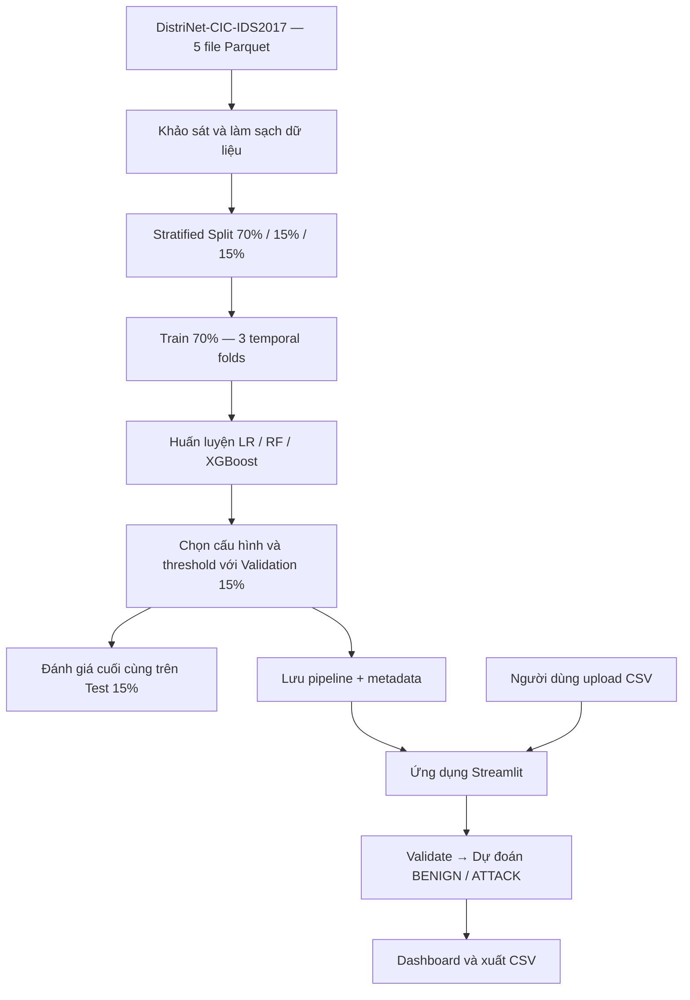

# NGHIÊN CỨU VÀ PHÁT TRIỂN HỆ THỐNG PHÁT HIỆN XÂM NHẬP MẠNG BẰNG HỌC MÁY

**Tên dự án:** DistriNet-CIC-IDS — Machine Learning-Based Network Intrusion Detection System  
**Loại bài toán:** Phân loại nhị phân (Binary Classification)  
**Bộ dữ liệu:** [DistriNet-CIC-IDS2017 (Kaggle)](https://www.kaggle.com/datasets/dhoogla/distrinetcicids2017)  
**Ngôn ngữ:** Python 3.11  
**Môi trường phát triển:** Visual Studio Code  
**Giao diện:** 

---

## Mục lục

1. [Giới thiệu đề tài](#1-giới-thiệu-đề-tài)
2. [Mục tiêu và phạm vi](#2-mục-tiêu-và-phạm-vi)
3. [Công nghệ sử dụng](#3-công-nghệ-sử-dụng)
4. [Cấu trúc thư mục](#4-cấu-trúc-thư-mục)
5. [Bộ dữ liệu và quy ước nhãn](#5-bộ-dữ-liệu-và-quy-ước-nhãn)
6. [Phương pháp và quy trình thực nghiệm](#6-phương-pháp-và-quy-trình-thực-nghiệm)
7. [Hướng dẫn cài đặt trên Visual Studio Code](#7-hướng-dẫn-cài-đặt-trên-visual-studio-code)
8. [Cách 1: Chạy ứng dụng bằng mô hình đã huấn luyện](#8-cách-1-chạy-ứng-dụng-bằng-mô-hình-đã-huấn-luyện)
9. [Cách 2: Huấn luyện lại từ bộ dữ liệu gốc](#9-cách-2-huấn-luyện-lại-từ-bộ-dữ-liệu-gốc)
10. [Hướng dẫn sử dụng ứng dụng](#10-hướng-dẫn-sử-dụng-ứng-dụng)
11. [Đánh giá kết quả và sản phẩm đầu ra](#11-đánh-giá-kết-quả-và-sản-phẩm-đầu-ra)
12. [Kiểm thử](#12-kiểm-thử)
13. [Các lỗi thường gặp](#13-các-lỗi-thường-gặp)

---

## 1. Giới thiệu đề tài

Cùng với sự phát triển của các hệ thống mạng, những hành vi như quét cổng, tấn công từ chối dịch vụ và dò quét thông tin có thể ảnh hưởng đến tính bảo mật và khả năng hoạt động của hệ thống. **Hệ thống phát hiện xâm nhập mạng (Network Intrusion Detection System — NIDS)** hỗ trợ phát hiện những luồng mạng có dấu hiệu tấn công để người quản trị tiếp tục kiểm tra và xử lý.

Đồ án nghiên cứu việc sử dụng **học máy có giám sát (Supervised Machine Learning)** để nhận diện lưu lượng mạng bình thường và lưu lượng nghi ngờ tấn công. Ba thuật toán được xây dựng, đánh giá và so sánh trên cùng bộ dữ liệu:

| Thuật toán | Vai trò trong đồ án | Đặc điểm chính |
|---|---|---|
| **Logistic Regression (LR)** | Baseline 1 | Mô hình tuyến tính, dễ làm mốc so sánh |
| **Random Forest (RF)** | Baseline 2 | Tập hợp nhiều cây quyết định, học quan hệ phi tuyến |
| **XGBoost (XGB)** | **Mô hình nghiên cứu chính** | Thuật toán boosting trên dữ liệu dạng bảng |

Đồ án bao gồm **hai phần liên kết**:

- **Phần nghiên cứu:** khảo sát dữ liệu, tiền xử lý, huấn luyện, so sánh, lựa chọn mô hình và đánh giá kết quả.
- **Phần ứng dụng:** xây dựng giao diện web cho phép tải lên tệp CSV chứa đặc trưng luồng mạng, kiểm tra dữ liệu, dự đoán nhị phân, trực quan hóa và xuất kết quả.

### Sơ đồ hoạt động tổng quát



## 2. Mục tiêu và phạm vi

### 2.1. Mục tiêu

1. Tìm hiểu nguyên lý IDS và các đặc trưng mô tả luồng mạng (network flow).
2. Làm sạch và chuẩn hóa bộ dữ liệu DistriNet-CIC-IDS2017.
3. Xây dựng ba mô hình Logistic Regression, Random Forest và XGBoost.
4. Khảo sát tác động của mất cân bằng dữ liệu với class weighting, **SMOTE chỉ tăng ATTACK** và **Random Undersampling chỉ giảm BENIGN**.
5. Đánh giá mô hình qua Accuracy, Precision, Recall, F1-score, FPR, FNR, ROC-AUC và Average Precision.
6. Phát triển ứng dụng có khả năng nhận CSV đúng schema, phân loại, hiển thị thống kê và xuất kết quả.

### 2.2. Phạm vi

**Đầu vào của mô hình:** Các đặc trưng số của luồng mạng đã được trích xuất và có cấu trúc tương thích với bộ dữ liệu huấn luyện.

**Đầu ra của mô hình:** Chỉ gồm hai lớp:

| Giá trị | Nhãn | Ý nghĩa |
|---|---|---|
| `0` | `BENIGN` | Luồng mạng được dự đoán là bình thường |
| `1` | `ATTACK` | Luồng mạng được dự đoán có dấu hiệu tấn công |

> **Quan trọng:** Đây là **bài toán phân loại nhị phân**, không phải phân loại đa lớp. Hệ thống **không dự đoán tên cuộc tấn công** (ví dụ DDoS hay PortScan). Phần thống kê theo tên loại tấn công, nếu có, chỉ phân tích tỷ lệ phát hiện ATTACK dựa trên nhãn gốc của dữ liệu kiểm thử.

Hệ thống hiện là bản **phân tích CSV theo lô (offline/batch)**: không tự bắt gói tin, đọc PCAP, giám sát mạng thời gian thực hoặc tự động chặn truy cập.

## 3. Công nghệ sử dụng

| Công nghệ / thư viện | Mục đích |
|---|---|
| Python 3.11 | Ngôn ngữ lập trình chính |
| Visual Studio Code | Phát triển và chạy chương trình |
| Pandas, NumPy | Xử lý và phân tích dữ liệu |
| PyArrow | Đọc, ghi tệp Parquet |
| Scikit-learn | Logistic Regression, Random Forest, chia dữ liệu, đánh giá |
| Imbalanced-learn | SMOTE, Random Undersampling, pipeline |
| XGBoost | Huấn luyện mô hình chính |
| Matplotlib, Plotly | Trực quan hóa kết quả |
| Streamlit | Xây dựng giao diện web |
| Joblib | Lưu/tải pipeline đã huấn luyện |
| Pytest | Kiểm thử mã nguồn |

Danh sách phiên bản tương thích được khai báo trong [`requirements.txt`](requirements.txt). Khuyến nghị sử dụng **Python 3.11** và môi trường ảo độc lập.

## 4. Cấu trúc thư mục

```text
distrinet-cic-ids/
│
├── data/
│   ├── raw/                      # 5 file Parquet gốc (người dùng tự tải)
│   ├── processed/                # Dữ liệu sạch, danh sách cột và các split
│   │   └── splits/               # train70, validation15, test15, temporal folds
│   └── samples/                  # CSV mẫu dùng để demo
│
├── notebooks/
│   └── Colab_reference.ipynb     # Notebook tham khảo từ Google Colab
│
├── src/
│   ├── cli.py                    # Các lệnh thực thi từ terminal
│   ├── config.py                 # Đường dẫn, seed và cấu hình chung
│   ├── data.py                   # Khảo sát và làm sạch dữ liệu
│   ├── split.py                  # Chia 70/15/15 và temporal folds
│   ├── models.py                 # Khai báo các pipeline ML
│   ├── train.py                  # Thí nghiệm temporal và full train
│   ├── metrics.py                # Tính metric, chọn threshold
│   ├── evaluate.py               # Đánh giá trên Test 15%
│   ├── inference.py              # Validate CSV và dự đoán
│   ├── plots.py                  # Tạo các biểu đồ
│   └── utils.py                  # Hàm tiện ích
│
├── models/                        # Các file .joblib và metadata .json
├── app/
│   └── app.py                    # Giao diện
├── tests/                         # Unit tests
├── results/                       # CSV và biểu đồ kết quả
├── .vscode/                       # Cấu hình chạy trong VS Code
├── requirements.txt
├── README.md
└── .gitignore
```

**Giải thích:** `data/processed/`, `models/` và `results/` là nơi chương trình sinh ra dữ liệu/mô hình/kết quả sau khi chạy. Bản mã nguồn không kèm dữ liệu gốc dung lượng lớn hay mô hình đã huấn luyện trên Colab; bạn cần **tự tải dữ liệu hoặc sao chép artifact** theo hướng dẫn bên dưới.

## 5. Bộ dữ liệu và quy ước nhãn

### 5.1. Nguồn dữ liệu

Bộ dữ liệu sử dụng là **DistriNet-CIC-IDS2017**, phiên bản được hiệu chỉnh liên quan đến CIC-IDS2017:

- Kaggle: <https://www.kaggle.com/datasets/dhoogla/distrinetcicids2017>
- Thông tin nghiên cứu của DistriNet: <https://intrusion-detection.distrinet-research.be/WTMC2021/tools_datasets.html>

Theo notebook tham khảo của nhóm, dữ liệu được tổ chức thành **năm tệp Parquet theo ngày**: Monday, Tuesday, Wednesday, Thursday và Friday. Các tệp có cùng schema.

### 5.2. Quy mô dữ liệu tham khảo

Số liệu dưới đây được ghi nhận trong **notebook Colab tham khảo**, không phải số liệu được dự án VS Code tự huấn luyện lại:

| Chỉ tiêu | Giá trị tham khảo |
|---|---:|
| Số file Parquet | 5 |
| Số bản ghi ban đầu | 1.787.358 |
| Số cột ban đầu | 83 (82 đặc trưng + `Label`) |
| Bản ghi có nhãn chứa `Attempted` | 8.966 |
| Bản ghi sau lọc `Attempted` | 1.778.392 |
| Bản ghi sau các bước làm sạch tiếp theo | 1.737.543 |
| Số đặc trưng đưa vào mô hình | 82 |

Nếu chạy với phiên bản hoặc tập file khác, cần lấy **số liệu thực tế trong `cleaning_report.json`**, không sao chép máy móc những con số tham khảo ở trên.

### 5.3. Các bước làm sạch

1. Đọc và kiểm tra schema của các file Parquet.
2. Loại bản ghi thiếu nhãn hoặc nhãn chứa `Attempted` (không phân biệt hoa/thường).
3. Chuyển nhãn: `BENIGN → 0`; các nhãn tấn công còn lại → `1`.
4. Kiểm tra kiểu dữ liệu số, chuyển `+Inf/-Inf` về giá trị thiếu khi cần.
5. Loại **toàn bộ các nhóm có cùng đặc trưng nhưng nhãn nhị phân mâu thuẫn** theo chính sách của đề tài.
6. Loại bản sao trùng đặc trưng, giữ lại một bản ghi đại diện.
7. Lưu dữ liệu sạch, danh sách đặc trưng và báo cáo số dòng bị loại.

Các cột `Label`, `target`, `_source_file` **không được dùng làm đầu vào X**. `Label` gốc được giữ lại chỉ để phân tích kết quả; `_source_file` phục vụ thống kê và temporal folds theo ngày.

**Không dùng thông tin Validation/Test để tính giá trị thay thế NaN:** `SimpleImputer` nằm trong pipeline và được fit từ Train.

## 6. Phương pháp và quy trình thực nghiệm

### 6.1. Chia dữ liệu theo hai tầng

**Tầng ngoài — Stratified 70/15/15**, với `random_state = 42`:

| Tập dữ liệu | Tỷ lệ | Vai trò |
|---|---:|---|
| Train | 70% | Huấn luyện mô hình; tạo temporal folds |
| Validation | 15% | Chọn cấu hình, threshold |
| Test | 15% | Đánh giá cuối cùng sau khi chốt mô hình |

**Tầng trong — Temporal folds**, chỉ tạo từ **Train 70%**:

| Fold | Giai đoạn huấn luyện | Ngày dùng để validation nội bộ |
|---|---|---|
| Fold 1 | Monday + Tuesday | Wednesday |
| Fold 2 | Monday + Tuesday + Wednesday | Thursday |
| Fold 3 | Monday → Thursday | Friday |

Temporal folds ở đây dựa vào **ngày trong tên tệp nguồn**, không phải timestamp chính xác của từng luồng mạng. Dữ liệu Train của mỗi fold chỉ bao gồm ngày trước ngày validation của fold đó.

> **Giới hạn cần nêu khi báo cáo:** Tầng ngoài là *stratified random split*, vì vậy các ngày vẫn xuất hiện trong cả Train, Validation và Test. **Test 15% không phải tập dữ liệu tương lai độc lập theo thời gian**. Kết quả temporal folds và kết quả Test ngẫu nhiên đo hai khía cạnh khác nhau, không được diễn giải như nhau.

### 6.2. Tiền xử lý theo thuật toán

| Thành phần | Logistic Regression | Random Forest | XGBoost |
|---|---|---|---|
| Xử lý NaN (`SimpleImputer`) | Có | Có | Có |
| `StandardScaler` | Có | Không bắt buộc / không dùng | Không bắt buộc / không dùng |
| Huấn luyện estimator | LogisticRegression | RandomForestClassifier | XGBClassifier |
| Xử lý mất cân bằng | Thử các cấu hình | Thử các cấu hình | Thử các cấu hình |

Các bước imputer, scaler và resampling đều nằm trong pipeline. Khi fit trên một temporal fold, chúng **chỉ học từ phần Train của fold đó**.

### 6.3. Xử lý mất cân bằng lớp

Dự án thử bốn cấu hình cho từng thuật toán trong temporal folds:

| Cấu hình | Cách thực hiện |
|---|---|
| `original` | Không cân bằng lại dữ liệu |
| `weighted` | Điều chỉnh trọng số lớp, không tạo/xóa dòng |
| `under-0.5` | **Chỉ giảm BENIGN (0)**, giữ nguyên ATTACK |
| `smote-0.5` | **Chỉ tăng ATTACK (1)**, giữ nguyên BENIGN |

Tất cả resampling dùng **duy nhất tỷ lệ 0.5**:

$$
\text{sampling ratio} = \frac{N_{\text{ATTACK}}}{N_{\text{BENIGN}}} = 0.5
$$

Ví dụ, nếu dữ liệu Train có 8.000 BENIGN và 2.000 ATTACK:

- `under-0.5`: giảm BENIGN từ 8.000 xuống 4.000; ATTACK giữ 2.000.
- `smote-0.5`: BENIGN giữ 8.000; ATTACK tăng từ 2.000 lên 4.000.

**Không có cấu hình SMOTE/Undersampling 0.8.** Validation và Test **không được resampling**. `weighted` là cấu hình thí nghiệm riêng, không được hiểu là vừa weighted vừa SMOTE.

**Lưu ý dễ nhầm:** `0.5` của resampling là **tỷ lệ số lượng lớp sau lấy mẫu**, khác với `threshold` dùng để chuyển điểm ATTACK thành dự đoán `0`/`1`.

### 6.4. Quy trình huấn luyện và lựa chọn

1. Chạy **4 cấu hình × 3 temporal folds = 12 thí nghiệm** cho mỗi thuật toán; tổng cộng 36 thí nghiệm nếu chạy đủ cả ba.
2. Đối chiếu F1, Recall, FPR, FNR, Average Precision và mức ổn định qua các ngày.
3. Huấn luyện lại các ứng viên đã chọn bằng **toàn bộ Train 70%**:
   - LR: `original`, `under-0.5`.
   - RF: `original`, `under-0.5`.
   - XGBoost: `original`, `weighted`.
4. Chọn ứng viên và **threshold** trên Validation 15%. Mặc định chương trình chọn theo F1 của ATTACK với điều kiện `FPR ≤ 1%` nếu có phương án đáp ứng.
5. Lưu mô hình đã chốt và metadata vào `models/`.
6. Chỉ sau đó mới đánh giá một lần trên Test 15%; **không điều chỉnh mô hình theo kết quả Test**.

Ở giai đoạn temporal, lệnh CLI mặc định lấy tối đa **50.000 bản ghi Train trên mỗi fold** (lấy mẫu phân tầng) để giảm thời gian chạy; **Validation của fold được giữ đầy đủ**. Các thí nghiệm này phục vụ lựa chọn sơ bộ, không có nghĩa tất cả mô hình chỉ được huấn luyện với 50.000 dòng. Lệnh `fit-final` mặc định sử dụng toàn bộ Train 70%.

### 6.5. Các chỉ số đánh giá

Trong bài toán này, **ATTACK = 1** là lớp dương:

| Ký hiệu | Ý nghĩa |
|---|---|
| TP | ATTACK được dự đoán đúng |
| TN | BENIGN được dự đoán đúng |
| FP | BENIGN bị cảnh báo nhầm là ATTACK |
| FN | ATTACK bị dự đoán nhầm thành BENIGN |

Các chỉ số chính:

- **Accuracy:** tỷ lệ dự đoán đúng trên toàn bộ dữ liệu.
- **Precision Attack = TP / (TP + FP):** mức chính xác của cảnh báo ATTACK.
- **Recall Attack = TP / (TP + FN):** tỷ lệ ATTACK được phát hiện.
- **F1 Attack:** trung bình điều hòa của Precision và Recall.
- **FPR = FP / (FP + TN):** tỷ lệ cảnh báo giả.
- **FNR = FN / (FN + TP):** tỷ lệ bỏ sót tấn công.
- **ROC-AUC:** khả năng phân biệt hai lớp trên nhiều threshold.
- **Average Precision (AP):** tóm tắt đường Precision–Recall, hữu ích với dữ liệu mất cân bằng.

Chương trình xuất Confusion Matrix nhị phân, ROC Curve, Precision–Recall Curve và bảng so sánh metric. AP tính bằng `average_precision_score`; không nên mặc định đồng nhất nó với mọi cách tính diện tích PR-AUC.

---

## 7. Hướng dẫn cài đặt trên Visual Studio Code

### 7.1. Yêu cầu trước khi chạy

- Đã cài **Python 3.11** (khuyến nghị), VS Code và tiện ích mở rộng **Python**.
- Máy có Internet để cài thư viện bằng `pip`.
- Đủ RAM/dung lượng nếu muốn đọc và huấn luyện lại trên năm file Parquet. Khi RAM hạn chế, nên **chạy ứng dụng bằng mô hình đã xuất từ Google Colab**.

### 7.2. Mở dự án

1. Giải nén thư mục `distrinet-cic-ids`.
2. Trong VS Code, chọn **File → Open Folder** và mở đúng thư mục `distrinet-cic-ids`.
3. Chọn **Terminal → New Terminal**.
4. Chạy lệnh ở **thư mục gốc** (nơi có `requirements.txt`).

### 7.3. Tạo môi trường ảo

**Windows (PowerShell):**

```powershell
py -3.11 -m venv .venv
.\.venv\Scripts\Activate.ps1
python -m pip install --upgrade pip
python -m pip install -r requirements.txt
```

Nếu PowerShell chặn lệnh kích hoạt, có thể dùng trực tiếp `.venv\Scripts\python.exe` thay cho `python` trong các lệnh, hoặc mở terminal **Command Prompt** và chạy `.venv\Scripts\activate.bat`.

**macOS / Linux:**

```bash
python3.11 -m venv .venv
source .venv/bin/activate
python -m pip install --upgrade pip
python -m pip install -r requirements.txt
```

Trong VS Code, nhấn `Ctrl+Shift+P` (macOS: `Cmd+Shift+P`) → **Python: Select Interpreter** → chọn Python thuộc thư mục `.venv`.

**Kiểm tra môi trường:**

```bash
python --version
python -m pytest --version
```

---

## 8. Cách 1: Chạy ứng dụng bằng mô hình đã huấn luyện

**Phù hợp nếu bạn đã huấn luyện xong trên Google Colab và chỉ muốn chạy ứng dụng/demo trên VS Code. Không cần huấn luyện lại.**

### 8.1. Sao chép mô hình từ Colab

Trong Google Drive, mở thư mục đã lưu artifact từ Colab (theo notebook của nhóm là `MyDrive/ThucTap/processed/models/`). Sao chép **cả file mô hình `.joblib` và metadata `.json`** vào `models/`:

```text
models/
├── lr_baseline1_final.joblib
├── lr_baseline1_metadata.json
├── rf_baseline2_final.joblib
├── rf_baseline2_metadata.json
├── xgb_main_final.joblib
└── xgb_main_metadata.json
```

Mỗi metadata cần chứa danh sách đặc trưng và threshold tương ứng. Ví dụ, notebook Colab tham khảo đã chốt threshold **LR 0.38, RF 0.31, XGBoost 0.58**; ứng dụng thực tế **đọc threshold từ metadata**, không gán cứng ba số trên.

> **Tương thích môi trường:** Mô hình Joblib được tạo với các phiên bản scikit-learn, XGBoost và imbalanced-learn nhất định. Nếu lỗi khi tải, cần dùng các phiên bản thư viện tương thích với môi trường huấn luyện. **Chỉ tải file `.joblib` do nhóm tự tạo hoặc từ nguồn tin cậy** vì Joblib sử dụng cơ chế tuần tự hóa có thể thực thi mã khi tải.

### 8.2. Khởi động ứng dụng

```bash
python -m streamlit run app/app.py
```

Mở địa chỉ Streamlit in ra trong terminal (thông thường là **http://localhost:8501**).

Bạn có thể chạy ứng dụng với **một mô hình** nếu chỉ sao chép artifact của mô hình đó và chọn đúng mô hình trên giao diện; để demo đầy đủ việc so sánh, cần có đủ cả ba cặp file.

### 8.3. Tạo dữ liệu demo

Nếu đã có `data/processed/splits/train70.parquet` và `data/processed/feature_columns.json`, chạy:

```bash
python -m src.cli sample --rows 100
```

Tệp được tạo: **`data/samples/sample_input.csv`**. Đây là 100 luồng lấy từ Train đã lưu, **không có nhãn thật**, dùng để kiểm tra luồng upload và suy luận — **không dùng để báo cáo Accuracy**.

Nếu chưa có `train70.parquet`, cần sao chép file split từ Colab hoặc thực hiện [Cách 2](#9-cách-2-huấn-luyện-lại-từ-bộ-dữ-liệu-gốc). Không thể tạo CSV mẫu bằng lệnh này khi chưa có dữ liệu Train.

---

## 9. Cách 2: Huấn luyện lại từ bộ dữ liệu gốc

**Phù hợp để tái lập đầy đủ thí nghiệm trên VS Code.** Các lệnh sau chạy theo thứ tự, từ thư mục gốc.

### Bước 1 — Chuẩn bị năm tệp Parquet

1. Tải bộ dữ liệu tại <https://www.kaggle.com/datasets/dhoogla/distrinetcicids2017>.
2. Giải nén các tệp Parquet (bản được hiệu chỉnh) vào `data/raw/`; chương trình có thể tìm trong thư mục con.
3. Đảm bảo dữ liệu đúng năm file theo ngày và có cột `Label`.

### Bước 2 — Khảo sát dữ liệu

```bash
python -m src.cli inspect
```

Chương trình in tên file, số dòng, số cột, tên cột và tối đa năm dòng đầu mỗi file; bước này đọc metadata nên không cần tải tất cả các cột của cả năm file vào RAM cùng lúc.

### Bước 3 — Làm sạch dữ liệu

```bash
python -m src.cli prepare
```

Các file chính được tạo:

```text
data/processed/ids_binary_clean.parquet
data/processed/feature_columns.json
data/processed/cleaning_report.json
```

### Bước 4 — Chia tập dữ liệu

```bash
python -m src.cli split
```

Kết quả được lưu trong `data/processed/splits/`:

```text
train70.parquet
validation15.parquet
test15.parquet
temporal_folds_train70.npz
outer_split_indices.npz
split_manifest.json
```

**Không thay đổi thứ tự dòng trong `train70.parquet`** sau khi tạo `temporal_folds_train70.npz`: các chỉ số temporal folds tham chiếu đúng thứ tự dòng đã lưu.

### Bước 5 — Chạy thí nghiệm trên ba temporal folds

```bash
python -m src.cli cv --model lr --max-train-rows 50000
python -m src.cli cv --model rf --max-train-rows 50000
python -m src.cli cv --model xgb --max-train-rows 50000
```

Mỗi lệnh chạy **12 thí nghiệm** (4 cấu hình × 3 temporal folds). Kết quả được lưu tại `results/temporal/`.

Để chạy tất cả các thuật toán bằng một lệnh:

```bash
python -m src.cli cv --model all --max-train-rows 50000
```

Để dùng **toàn bộ Train bên trong mỗi temporal fold** thay vì lấy mẫu 50.000 dòng, sử dụng `--max-train-rows 0`. Cách này tốn thêm thời gian và RAM.

### Bước 6 — Huấn luyện cuối và lựa chọn threshold

```bash
python -m src.cli fit-final --model lr
python -m src.cli fit-final --model rf
python -m src.cli fit-final --model xgb
```

Hoặc:

```bash
python -m src.cli fit-final --model all
```

Đây là giai đoạn huấn luyện bằng **toàn bộ Train 70%**, so sánh ứng viên trên Validation 15%, lựa chọn threshold và xuất artifact. Kết quả Validation lưu trong `results/validation/`; mô hình và metadata lưu trong `models/`.

Mặc định giới hạn FPR trong tìm threshold là `0.01` (1%). Có thể cấu hình qua `--fpr-limit`, nhưng phải lựa chọn mục tiêu **trước khi đánh giá Test**.

### Bước 7 — Đánh giá Test cuối cùng

```bash
python -m src.cli evaluate
```

Lệnh sẽ tải ba mô hình đã chốt và dự đoán trên **cùng Test 15%**. Không train lại, không tìm threshold mới, không điều chỉnh cấu hình từ kết quả Test.

Các báo cáo được lưu trong `results/test_final/`.

### Bước 8 — Tạo CSV mẫu và mở ứng dụng

```bash
python -m src.cli sample --rows 100
python -m streamlit run app/app.py
```

**Mẹo kiểm tra kỹ thuật:** Có thể thử lệnh `cv`/`fit-final` với `--quick` để xác nhận thư viện và pipeline hoạt động; **không dùng kết quả `--quick` làm kết quả nghiên cứu**, vì chương trình giảm số cây/số vòng huấn luyện.

---

## 10. Hướng dẫn sử dụng ứng dụng

### 10.1. Các bước thao tác

1. Mở ứng dụng Streamlit trên trình duyệt.
2. Ở thanh bên trái, chọn **Logistic Regression**, **Random Forest** hoặc **XGBoost**.
3. Kiểm tra cấu hình, số đặc trưng bắt buộc và threshold đã lưu.
4. Chọn **Upload CSV** và tải tệp dữ liệu lên.
5. Xem năm dòng đầu để xác nhận dữ liệu.
6. Nhấn **Validate & Predict**.
7. Xem thống kê tổng số luồng, số `BENIGN`, số `ATTACK`, biểu đồ phân bố và bảng dự đoán.
8. Nhấn **Xuất kết quả CSV** để tải kết quả về máy.

### 10.2. Yêu cầu đối với file CSV

Tệp tải lên phải chứa **đủ các cột đặc trưng** với tên và ý nghĩa tương ứng với `feature_columns` trong metadata. Với bộ dữ liệu notebook tham khảo là **82 đặc trưng số**.

Ứng dụng:

- Kiểm tra tên cột bắt buộc và phát hiện cột thiếu.
- Kiểm tra dữ liệu không chuyển được sang dạng số.
- Sử dụng imputer đã fit trong pipeline để xử lý giá trị thiếu/vô hạn phù hợp.
- Có thể bỏ qua cột thừa (ví dụ `Label` hoặc `target`) khi tạo đầu vào dự đoán.
- Giới hạn bản demo ở **75 MB/tệp và 200.000 dòng/lần upload**.

**Không hỗ trợ trực tiếp:** file `.pcap`, log tùy ý hoặc CSV chỉ có `Source IP`, `Destination IP`, `Protocol`. Những file như vậy chưa có đủ đặc trưng flow mà mô hình được huấn luyện để đọc.

### 10.3. Kết quả dự đoán

File CSV xuất ra gồm các cột dự đoán được thêm vào cuối dữ liệu đầu vào:

| Cột | Ý nghĩa |
|---|---|
| `row_id` | Số thứ tự luồng trong file CSV |
| `predicted_target` | Nhãn dự đoán `0` hoặc `1` |
| `predicted_label` | `BENIGN` hoặc `ATTACK` |
| `attack_score` | Điểm dự đoán của lớp ATTACK |
| `threshold` | Ngưỡng chuyển điểm thành nhãn nhị phân |

Ví dụ **minh họa (không phải kết quả thử nghiệm):**

```csv
row_id,predicted_target,predicted_label,attack_score,threshold
1,0,BENIGN,0.12,0.58
2,1,ATTACK,0.94,0.58
```

Nếu CSV có nhãn thật `target` (0/1) hoặc `Label`, ứng dụng còn có thể tính một số metric để tham khảo. Nếu không có nhãn thật thì **không thể tính Accuracy, Recall, FPR hoặc F1**, chỉ có kết quả dự đoán. Điểm ATTACK chưa chắc là xác suất đã được hiệu chỉnh cho môi trường thực tế.

## 11. Đánh giá kết quả và sản phẩm đầu ra

### 11.1. Nơi lưu kết quả

| Đường dẫn | Nội dung |
|---|---|
| `results/temporal/` | Bảng metric, trung bình ba folds, biểu đồ phân bố và so sánh temporal |
| `results/validation/` | Bảng chọn ứng viên, bảng threshold, biểu đồ/đánh giá Validation |
| `results/test_final/` | Kết quả Test cuối cùng, bảng dự đoán, Confusion Matrix, ROC/PR |
| `models/` | Ba pipeline `.joblib` cùng metadata `.json` |
| `data/samples/sample_input.csv` | CSV không nhãn để trình diễn ứng dụng |

Một số file đáng chú ý sau khi đánh giá Test:

```text
results/test_final/
├── final_test_metrics_3models.csv
├── final_test_predictions.csv
├── final_test_by_day.csv
├── final_test_by_attack_type.csv
├── lr_confusion.png
├── lr_roc.png
├── lr_pr.png
├── rf_confusion.png
├── rf_roc.png
├── rf_pr.png
├── xgb_confusion.png
├── xgb_roc.png
└── xgb_pr.png
```

Tên và danh sách file phụ thuộc phiên bản mã nguồn; các file được tạo khi chạy thực tế, **không phải có sẵn trong ZIP mã nguồn**.

### 11.2. Kết quả tham khảo từ notebook Google Colab

Bảng dưới đây trích từ tài liệu phương pháp `docs/METHODOLOGY.md` (dựa trên kết quả Test trong notebook tham khảo). Đây **không phải kết quả chạy lại của dự án VS Code trong môi trường hiện tại**:

| Mô hình | Cấu hình được chọn | Threshold từ Validation | Test F1 Attack | Test Recall Attack | Test FPR |
|---|---|---:|---:|---:|---:|
| Logistic Regression | Original | 0.38 | 0.984999 | 0.981788 | 0.002257 |
| Random Forest | Original | 0.31 | 0.998756 | 0.999526 | 0.000389 |
| **XGBoost** | **Weighted** | **0.58** | **0.998768** | **0.999787** | **0.000435** |

Các chỉ số Test bổ sung (cùng ngưỡng đã chọn trên Validation):

| Mô hình | Accuracy | Precision Attack | FNR | ROC-AUC | Average Precision (AP) |
|---|---:|---:|---:|---:|---:|
| Logistic Regression | 0.995162 | 0.988232 | 0.018212 | 0.998608 | 0.996127 |
| Random Forest | 0.999597 | 0.997987 | 0.000474 | 0.999993 | 0.999954 |
| XGBoost | 0.999601 | 0.997752 | 0.000213 | 0.999994 | 0.999964 |

**Diễn giải:** XGBoost có Test F1 nhỉnh hơn RF trong kết quả notebook tham khảo, nhưng RF có FPR thấp hơn. Không nên kết luận một mô hình luôn vượt trội trong mọi môi trường; cần cân nhắc cả chi phí cảnh báo giả, bỏ sót tấn công và khả năng tổng quát hóa theo thời gian.

**Phân tích bổ sung theo nhóm tấn công:** File `final_test_by_attack_type.csv` chỉ tính *Recall ATTACK trong từng nhóm nhãn gốc*, không phải kết quả phân loại chính xác từng loại tấn công.

> **Cảnh báo khoa học quan trọng:** Một số temporal folds trong notebook tham khảo có Recall/F1 rất thấp dù Test phân tầng ngẫu nhiên có chỉ số cao. Điều này phải được báo cáo như một hạn chế về chuyển dịch phân bố theo ngày/loại tấn công, không được bỏ qua khi trình bày kết quả.

## 12. Kiểm thử

Sau khi cài `requirements.txt`, chạy:

```bash
python -m pytest -q
```

Các test kiểm tra một số chức năng xử lý dữ liệu, chia tập, quy ước nhãn, resampling, pipeline và suy luận bằng **dữ liệu giả lập**. Trong môi trường kiểm tra khi chuẩn bị bản bàn giao: **15 tests đạt, 1 test được bỏ qua** (test liên quan Parquet cần môi trường có PyArrow phù hợp). Kết quả trên máy người dùng có thể khác nếu thiếu thư viện hoặc khác phiên bản.

**Cần phân biệt:** Unit tests đạt chỉ chứng minh các tình huống đã thiết kế hoạt động đúng; không đồng nghĩa độ chính xác trên dữ liệu mạng thực tế đã được xác nhận. Muốn kiểm tra toàn bộ quy trình, cần chạy với năm tệp Parquet thật, ba artifact thật và CSV demo tương ứng.

Gợi ý kiểm thử ứng dụng trước khi nộp:

| Tình huống | Kết quả mong đợi |
|---|---|
| Upload CSV đủ các đặc trưng | Dự đoán và xuất kết quả thành công |
| CSV thiếu cột | Thông báo các đặc trưng còn thiếu |
| CSV có giá trị chữ trong cột số | Thông báo giá trị/cột không hợp lệ |
| CSV không có nhãn thật | Không hiển thị Accuracy/F1 giả |
| CSV có nhãn thật | Tính metric theo quy ước `ATTACK = 1` |
| Chọn LR, RF và XGBoost | Tải đúng mô hình/metadata, dùng đúng threshold |
| Cùng CSV, cùng model và threshold | Kết quả dự đoán có thể tái lập |

## 13. Các lỗi thường gặp

| Lỗi / biểu hiện | Nguyên nhân thường gặp | Cách khắc phục |
|---|---|---|
| `python` hoặc `py` không tìm thấy | Chưa cài Python, PATH chưa đúng | Cài Python 3.11, mở lại terminal |
| `ModuleNotFoundError` | Cài thư viện sai môi trường | Kích hoạt `.venv`, chạy `python -m pip install -r requirements.txt` |
| `FileNotFoundError: models/...` | Chưa có `.joblib` hoặc metadata | Copy các artifact Colab vào `models/` hoặc chạy `fit-final` |
| Không tìm thấy Parquet | `data/raw/` trống hoặc sai định dạng | Tải/giải nén đúng năm file Parquet |
| CSV thiếu đặc trưng | Đầu vào không cùng schema huấn luyện | Dùng `sample_input.csv`, đối chiếu metadata |
| Lỗi khi tải `.joblib` | Khác phiên bản thư viện hoặc artifact lỗi | Đồng bộ phiên bản với Colab, dùng artifact tin cậy |
| Chạy `prepare`/`fit-final` bị hết RAM | Dữ liệu và mô hình lớn | Đóng tiến trình khác, dùng máy RAM cao hơn hoặc dùng model đã train trên Colab |
| Không vào được trang Streamlit | Server chưa chạy hoặc cổng bận | Kiểm tra URL hiển thị trong terminal |
| Kết quả khác notebook gốc | Khác phiên bản thư viện/split/kiểu xử lý | Kiểm tra seed, dữ liệu, metadata, schema và các file split |

## 14. Giới hạn và hướng phát triển

### Giới hạn hiện tại

1. **Chỉ phân loại nhị phân:** hệ thống chưa định danh loại tấn công.
2. **Chỉ làm việc trên flow features đã trích xuất:** chưa có module đọc trực tiếp PCAP hoặc bắt gói tin thời gian thực.
3. **Giới hạn dữ liệu:** bộ dữ liệu nghiên cứu không đại diện cho tất cả lưu lượng mạng hiện đại.
4. **Giới hạn đánh giá:** outer split phân tầng ngẫu nhiên có thể đánh giá lạc quan hơn so với triển khai trên dữ liệu tương lai hoặc tấn công chưa thấy.
5. **Chi phí tài nguyên:** huấn luyện trên hàng triệu dòng có thể tốn RAM và CPU đáng kể.
6. **Rủi ro trong ứng dụng thực tế:** nhiều False Positive có thể gây quá tải cảnh báo; False Negative có thể bỏ sót tấn công.

### Hướng phát triển

- Tích hợp bước trích xuất network flow từ PCAP hoặc công cụ phù hợp.
- Bổ sung giám sát/đánh giá theo dòng dữ liệu mới và theo thời gian thực.
- Thử nghiệm trên các bộ dữ liệu mới và tập holdout theo ngày/mạng hoàn toàn độc lập.
- Tối ưu đặc trưng, độ trễ dự đoán, tài nguyên sử dụng và hiệu chỉnh điểm dự đoán.
- Bổ sung phân quyền, nhật ký hoạt động, kiểm soát tệp upload và cơ chế cảnh báo cho quản trị viên.
