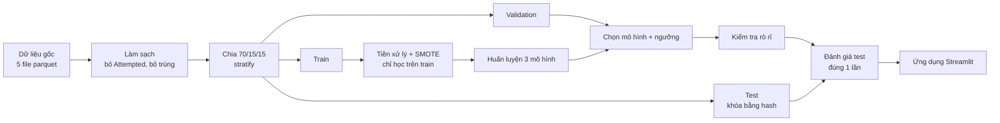

# Ứng dụng Machine Learning vào hệ thống phát hiện nguy cơ an ninh mạng

Ứng dụng web phát hiện xâm nhập mạng (IDS) dùng Machine Learning, huấn luyện trên bộ dữ liệu **CIC-IDS2017, bản sửa lỗi của Distrinet**.

- **Phân tích file CSV:** tải lên file luồng mạng (82 đặc trưng CICFlowMeter), ứng dụng kiểm tra dữ liệu, chấm điểm từng luồng, hiển thị kết quả, và xuất ra **CSV, Excel hoặc báo cáo PDF**.
- **Giám sát mạng trực tiếp (thử nghiệm, chỉ Windows):** bắt gói tin trên Wi-Fi hoặc dây mạng, gom thành luồng và đánh giá liên tục trên màn hình radar.

Mô hình cuối cùng là **XGBoost**, ngưỡng cảnh báo **0,570**. Kết quả trên tập test độc lập (chỉ đánh giá một lần):

| F1 | Recall | Precision | FPR (báo động nhầm) | FNR (bỏ sót) | PR-AUC |
| --- | --- | --- | --- | --- | --- |
| 0,9988 | 99,98% | 99,78% | 0,044% | 0,024% | 0,9999 |

---

## Mục lục

1. [Chạy nhanh](#chạy-nhanh)
2. [Cách 1: Chạy bằng Docker](#cách-1-chạy-bằng-docker)
3. [Cách 2: Chạy bằng Python](#cách-2-chạy-bằng-python)
4. [Hướng dẫn sử dụng](#hướng-dẫn-sử-dụng)
5. [Kiểm thử](#kiểm-thử)
6. [Huấn luyện lại từ đầu](#huấn-luyện-lại-từ-đầu)
7. [Cấu trúc thư mục](#cấu-trúc-thư-mục)
8. [Kết quả mô hình](#kết-quả-mô-hình)
9. [Các biện pháp chống rò rỉ dữ liệu](#các-biện-pháp-chống-rò-rỉ-dữ-liệu)
10. [Hạn chế](#hạn-chế)
11. [Xử lý sự cố](#xử-lý-sự-cố)

---

## Chạy nhanh

Repository đã có sẵn **mô hình đã huấn luyện** (`models/final_model.joblib`) và **4 file CSV mẫu** (`data/samples/`). Muốn dùng ứng dụng thì **không cần tải dữ liệu, không cần huấn luyện lại**. Chọn một trong hai cách:

| | Cách 1: Docker | Cách 2: Python |
| --- | --- | --- |
| Cần cài | Docker Desktop | Python 3.13 |
| Hệ điều hành | Windows, macOS, Linux | Windows, macOS, Linux |
| Phân tích file CSV | Có | Có |
| Giám sát trực tiếp | Không | Có (chỉ Windows) |
| Chạy kiểm thử, huấn luyện lại | Không | Có |

Trước tiên, tải mã nguồn về máy (cần [Git](https://git-scm.com/downloads)), hoặc bấm **Code → Download ZIP** trên GitHub rồi giải nén:

```bash
git clone --branch ttthuhien https://github.com/VNDT1625/DTG_ProjectGroup3DT_AI.git
cd DTG_ProjectGroup3DT_AI
```

Nếu tải ZIP, nhớ chọn nhánh **ttthuhien** trước khi bấm Download ZIP.

## Cách 1: Chạy bằng Docker

1. Cài và mở [Docker Desktop](https://www.docker.com/products/docker-desktop/), đợi đến khi hiện **Engine running**.
2. Trong thư mục dự án, chạy:

```bash
docker build -t ids-app .
docker run --rm -p 8501:8501 --name ids-app ids-app
```

3. Mở trình duyệt tại **http://localhost:8501**.

- Lần build đầu mất khoảng 3–8 phút để tải thư viện. Các lần sau, nếu chỉ sửa code, build lại mất vài giây.
- Muốn dừng: nhấn **Ctrl + C** trong cửa sổ lệnh (hoặc chạy `docker stop ids-app`). Lần sau chỉ cần chạy lại lệnh `docker run`.
- Giao diện trong Docker giống hệt khi chạy bằng Python. Riêng **giám sát trực tiếp** không chạy được, vì container tách biệt với card mạng thật; bấm vào chế độ này sẽ thấy giải thích.
- Image chỉ chứa code, mô hình và file mẫu; **không** chứa dữ liệu gốc. Thư viện được ghim trong `requirements-docker.txt`.

## Cách 2: Chạy bằng Python

Cần **Python 3.13** ([tải tại python.org](https://www.python.org/downloads/); trên Windows, khi cài nhớ tích **Add python.exe to PATH**). Các thư viện được ghim đúng phiên bản lúc huấn luyện, để mô hình nạp đúng.

**Windows (Command Prompt):**

```cmd
py -3.13 -m venv .venv
.venv\Scripts\activate
python -m pip install --upgrade pip
pip install -r requirements.txt
streamlit run app\app.py
```

**macOS / Linux:**

```bash
python3.13 -m venv .venv
source .venv/bin/activate
python -m pip install --upgrade pip
pip install -r requirements.txt
streamlit run app/app.py
```

Trình duyệt tự mở tại `http://localhost:8501`. Muốn dừng: nhấn **Ctrl + C**.

- Sau lệnh `activate`, đầu dòng lệnh có chữ `(.venv)`. Mỗi lần mở cửa sổ lệnh mới, chạy lại lệnh `activate` trước.
- Dùng **PowerShell** thay cho cmd: lệnh kích hoạt là `.venv\Scripts\Activate.ps1`. Nếu bị chặn, chạy trước `Set-ExecutionPolicy -Scope CurrentUser RemoteSigned`.
- Muốn cài **đúng từng phiên bản** như máy phát triển (kể cả thư viện phụ): `pip install -r requirements-lock.txt`.

## Hướng dẫn sử dụng

### Phân tích file CSV

1. **Tải dữ liệu:** kéo thả file CSV (tối đa 1 GB) có đủ 82 cột đặc trưng. Thử ngay với các file trong `data/samples/`:

| File | Nội dung | Kết quả mong đợi |
| --- | --- | --- |
| `demo_labeled.csv` | 5.481 luồng, có cột `Label` | 1.478 tấn công, 4.003 bình thường, có thêm phần so với nhãn thực tế |
| `demo_unlabeled.csv` | Cùng dữ liệu, không có `Label` | Như trên, không có phần so sánh |
| `case_no_attack.csv` | 4.000 luồng bình thường | Thông báo không phát hiện tấn công |
| `case_all_invalid.csv` | 200 dòng đều có ô lỗi | Báo lỗi, chỉ rõ cột `Flow Bytes/s` |

2. **Kiểm tra dữ liệu:** ứng dụng báo bằng tiếng Việt khi file rỗng, sai định dạng, thiếu cột, có ô chứa chữ, giá trị vô cực hoặc ô trống. Tự nhận dấu phân cách `,` `;` Tab `|`. Dòng có ô lỗi được đánh dấu **"Không đủ dữ liệu"** và không được dự đoán.
3. **Phát hiện tấn công:** khung kết quả cho biết số luồng tấn công, bình thường, không đủ dữ liệu. Ba nút bên dưới chuyển giữa:
   - **Chi tiết từng luồng:** bảng có lọc theo kết quả, theo xác suất, và sắp xếp.
   - **Phân bố xác suất:** biểu đồ số luồng theo xác suất tấn công, có vạch ngưỡng.
   - **So với nhãn thực tế** (khi file có cột `Label`): Accuracy, Precision, Recall, F1, FPR, FNR, ma trận nhầm lẫn và tỉ lệ đúng theo từng loại nhãn.
4. **Xuất kết quả:**
   - **CSV:** đầy đủ mọi dòng, thêm 3 cột `Ket_qua`, `Xac_suat_tan_cong`, `Ly_do` vào trước các cột gốc.
   - **Excel (.xlsx):** tối đa 200.000 dòng, tô màu cột kết quả, có sheet tóm tắt. Nên dùng Excel thay cho CSV nếu mở bằng Microsoft Excel trên máy dùng định dạng số Việt Nam (dấu phẩy thập phân).
   - **Báo cáo PDF:** tóm tắt 2–4 trang để nộp hoặc gửi.

**Thanh bên trái** có thanh trượt và đồng hồ **ngưỡng cảnh báo** (mặc định 0,57). Hạ ngưỡng để bắt nhiều tấn công hơn, đổi lại dễ báo nhầm hơn. Ứng dụng chỉ dùng mô hình đã học trên tập train, không học lại gì từ file tải lên; cột `Label` không bao giờ được đưa vào mô hình.

### Giám sát mạng trực tiếp (thử nghiệm, chỉ Windows)

- **Mở cmd bằng quyền Administrator** rồi chạy ứng dụng. Ứng dụng dùng raw socket có sẵn của Windows, không cần cài thêm, nhưng chỉ đọc được IPv4.
- Nếu máy có cài [Npcap](https://npcap.com), ứng dụng tự dùng Npcap: đọc được cả IPv6 và không cần quyền Administrator.
- Chọn Wi-Fi, dây mạng, hoặc cả hai, rồi bấm **Bắt đầu**. Một luồng được đánh giá khi kết nối đóng, hoặc sau 15 giây không có gói tin mới.
- Chỉ giám sát mạng của bạn hoặc mạng bạn được phép giám sát.

## Kiểm thử

Bộ kiểm thử tự động (pytest) nằm trong `tests/`, chạy với **mô hình thật**:

```bash
python -m pytest tests -v
```

| File | Kiểm tra |
| --- | --- |
| `test_validation.py` | Đọc CSV: file rỗng, nhị phân, quá dung lượng, bảng mã, dấu phân cách, thiếu cột, ô chữ, vô cực, ô trống, cột `Label` |
| `test_prediction.py` | Mô hình nạp đúng, ngưỡng áp dụng đúng, nhãn không ảnh hưởng dự đoán, không học lại từ file người dùng, kết quả ổn định, chất lượng trên file mẫu |
| `test_dashboard.py` | Các ô số liệu, bảng theo nhãn, đổi ngưỡng không cần tính lại, 3 trường hợp có / không tấn công / toàn dòng lỗi |
| `test_export.py` | Xuất CSV và Excel: số dòng, thứ tự cột, giá trị gốc không đổi, tiếng Việt, lọc "chỉ tấn công", file xuất tải lên lại được |
| `test_report_pdf.py` | Tạo báo cáo PDF trong mọi trường hợp, nội dung tiếng Việt |

Một vài bài sẽ báo `skipped` nếu thiếu thư viện tùy chọn (ví dụ `pypdf`); điều này là bình thường.

**Đo hiệu năng** với file 100 nghìn, 500 nghìn và 1 triệu dòng: `python src/s09_benchmark.py` (kết quả trong `reports/s09_benchmark.csv`). Trên máy phát triển, file 1 triệu dòng (393 MB) được đọc, kiểm tra, dự đoán và xuất CSV trong khoảng 27 giây, dùng tối đa khoảng 3,2 GB RAM.

## Huấn luyện lại từ đầu

> Chỉ cần khi muốn tái lập kết quả. Ứng dụng đã có sẵn mô hình.

**1. Tải dữ liệu** (khoảng 250 MB, không có trên GitHub) từ [kaggle.com/datasets/dhoogla/distrinetcicids2017](https://www.kaggle.com/datasets/dhoogla/distrinetcicids2017):

- Dùng Kaggle API (cần file `kaggle.json`, xem [hướng dẫn](https://www.kaggle.com/docs/api)):
  ```bash
  kaggle datasets download -d dhoogla/distrinetcicids2017 -p data/raw --unzip
  ```
- Hoặc tải thủ công, rồi giải nén 5 file `.parquet` vào `data/raw/`: `Benign-Monday.parquet`, `Bruteforce-Tuesday.parquet`, `DoS-Wednesday.parquet`, `Infiltration-Webattacks-Thursday.parquet`, `Portscan-DDos-Botnet-Friday.parquet`.

**2. Chạy lần lượt các bước** (đã kích hoạt `.venv`, đứng ở thư mục dự án). Mỗi bước ghi nhật ký vào `logs/` và kết quả vào `reports/`. Hạt giống ngẫu nhiên cố định (`random_state = 42`), nên chạy lại ra cùng kết quả.

| Bước | Lệnh | Việc làm | Thời gian |
| --- | --- | --- | --- |
| 0 | `python src\s00_check_environment.py` | Kiểm tra thư viện, lưu hash dữ liệu gốc | < 1 phút |
| 1 | `python src\s01_data_overview.py` | Thống kê dữ liệu thô (chỉ đọc) | ~ 1 phút |
| 2 | `python src\s02_clean_data.py` | Làm sạch, gán nhãn 0/1 | ~ 1 phút |
| 3 | `python src\s03_split_data.py` | Chia 70/15/15, khóa test bằng hash | ~ 1 phút |
| 4 | `python src\s04_preprocess.py` | Tiền xử lý + cân bằng, chỉ trên train | ~ 1 phút |
| 5 | `python src\s05_train_models.py` | Huấn luyện 3 mô hình, chọn mô hình và ngưỡng trên validation | ~ 5 phút |
| 6 | `python src\s06_leakage_checks.py` | 4 phép kiểm tra rò rỉ | ~ 5 phút |
| 6.5 | `python src\s06b_temporal_split.py` | Thí nghiệm chia theo thời gian (chỉ dùng train) | ~ 4 phút |
| 6.5b | `python src\s06c_per_class_recall.py` | Recall riêng của Attack và Benign cho từng lượt | < 1 phút |
| 6.6 | `python src\s06d_fpr_thresholds.py` | Ngưỡng 0,5 so với ngưỡng theo FPR | ~ 5 phút |
| 7 | `python src\s07_evaluate_test.py` | Đánh giá trên test, **chỉ một lần** | ~ 1 phút |
| 7b | `python src\s07b_fpr_fnr.py` | Tính FPR và FNR từ kết quả đã lưu | < 1 phút |
| 8 | `python src\s08_make_samples.py` | Tạo 2 file CSV mẫu cho ứng dụng | < 1 phút |
| 9 | `python src\s09_benchmark.py` | Đo hiệu năng ứng dụng với file lớn | ~ 3 phút |
| 10 | `python src\s10_make_dashboard_cases.py` | Tạo 2 file mẫu cho trường hợp đặc biệt | < 1 phút |

Trên macOS / Linux, thay `\` bằng `/` trong đường dẫn.

> **Về bước 7:** lần chạy đầu tạo file khóa `models/test_lock.json`; các lần sau chỉ in lại kết quả cũ, không đánh giá lại tập test. Repository đã chứa file khóa của lần đánh giá chính thức (12/11/2026). Muốn đánh giá lại từ đầu trên dữ liệu của bạn, hãy xóa file khóa này **sau khi** đã chạy lại các bước 2–5.

**Yêu cầu của đề bài được tuân thủ:**

- Dữ liệu CIC-IDS2017 bản sửa lỗi của Distrinet, file parquet (không dùng bản gốc).
- Nhãn nhị phân: Benign = 0, còn lại = 1; bỏ các nhãn có chữ "Attempted".
- Chia train / validation / test 70 / 15 / 15, stratify theo nhãn.
- Scaler, encoder, SMOTE, undersampling và chọn đặc trưng chỉ fit trên train; không đụng vào test khi tinh chỉnh.



## Cấu trúc thư mục

```
DTG_ProjectGroup3DT_AI/
├── app/                        Ứng dụng Streamlit
│   ├── app.py                  Trang chính: tải file, kiểm tra, kết quả, xuất file
│   ├── validation.py           Đọc và kiểm tra CSV, dự đoán, so với nhãn
│   ├── export.py               Xuất CSV và Excel
│   ├── report_pdf.py           Tạo báo cáo PDF
│   ├── ui.py                   Giao diện: màu sắc, hiệu ứng, các khối hiển thị
│   ├── live_view.py            Màn hình giám sát trực tiếp
│   ├── live_monitor.py         Bắt gói tin (raw socket Windows hoặc Npcap)
│   └── flow_builder.py         Gom gói tin thành luồng, tính 82 đặc trưng
├── src/                        Các bước huấn luyện, chạy theo thứ tự s00 → s10
│   └── ids_pipeline.py         Dây chuyền tiền xử lý (mô hình cần file này khi nạp)
├── models/
│   ├── final_model.joblib      XGBoost + tiền xử lý, ngưỡng 0,570 (ứng dụng dùng file này)
│   ├── candidate_*.joblib      3 mô hình ứng viên
│   ├── feature_cols.json       Danh sách 82 cột đặc trưng
│   └── test_lock.json          Khóa và kết quả của lần đánh giá test
├── data/
│   ├── samples/                4 file CSV mẫu để thử ứng dụng
│   ├── raw/                    (không có trên GitHub) dữ liệu gốc từ Kaggle
│   └── processed/              (không có trên GitHub) dữ liệu đã xử lý
├── tests/                      Kiểm thử tự động (pytest)
├── reports/                    Bảng CSV và biểu đồ PNG kết quả
├── logs/                       Nhật ký của từng bước
├── .streamlit/config.toml      Giao diện tối, cho phép tải file đến 1 GB
├── Dockerfile, .dockerignore   Đóng gói ứng dụng bằng Docker
├── requirements.txt            Thư viện cần cài (đã ghim phiên bản)
├── requirements-lock.txt       Phiên bản chính xác của mọi thư viện khi phát triển
└── requirements-docker.txt     Thư viện cho Docker (chỉ phần ứng dụng)
```

## Kết quả mô hình

**So sánh 3 mô hình trên tập test**

Ngưỡng của mỗi mô hình được chọn trên validation.

| Mô hình | Ngưỡng | PR-AUC | F1 | Recall | FPR | FNR |
| --- | --- | --- | --- | --- | --- | --- |
| **XGBoost** (được chọn) | 0,570 | 0,9999 | 0,9988 | 99,98% | 0,044% | 0,024% |
| Random Forest | 0,562 | 0,9998 | 0,9989 | 99,97% | 0,038% | 0,033% |
| Logistic Regression | 0,827 | 0,9594 | 0,9452 | 93,27% | 0,790% | 6,730% |

**Kiểm tra rò rỉ dữ liệu (cả 3 phép đều đạt)**

| Phép kiểm tra | Kết quả |
| --- | --- |
| Xáo trộn nhãn train | PR-AUC 0,155 (mức cơ sở 0,162), ROC-AUC 0,502: mô hình không học được gì khi nhãn bị xáo |
| Từng đặc trưng riêng lẻ | Cột mạnh nhất chỉ đạt ROC-AUC 0,986: không có cột nào là "đáp án trá hình" |
| Train so với validation | Chênh lệch tối đa 0,0002: không học vẹt |

**Thí nghiệm theo thời gian (cửa sổ 3 ngày, chỉ dùng train), XGBoost**

| Lượt | Học → Kiểm tra | Chỉ số | Ngưỡng 0,5 | Ngưỡng FPR ≤ 1% | Ngưỡng FPR ≤ 0,1% |
| --- | --- | --- | --- | --- | --- |
| 1 | Thứ Hai–Tư → Thứ Năm | Recall (Attack) | 0,03% | 11,95% | 1,43% |
| 2 | Thứ Ba–Năm → Thứ Sáu | Recall (Attack) | 3,06% | 99,39% | 92,14% |
| 3 | Thứ Tư–Sáu → Thứ Hai | Recall (Benign) | 99,99% | 98,72% | 99,93% |

Ngưỡng theo FPR được chọn chỉ trên các luồng **Benign** của validation thuộc các ngày huấn luyện. Vì chỉ cần lưu lượng bình thường, cách này áp dụng được cả khi chưa biết trước kiểu tấn công mới.

Các biểu đồ nằm trong `reports/`:

- Tập test: `s07_confusion_matrix.png`, `s07_roc_curve.png`, `s07_pr_curve.png`, `s07_accuracy_by_label.png`
- Thí nghiệm 6.5 và 6.6: `s06b_temporal_split.png`, `s06d_fpr_thresholds.png`

## Các biện pháp chống rò rỉ dữ liệu

| Nguy cơ | Biện pháp |
| --- | --- |
| Dòng trùng nằm ở cả train lẫn test | Bỏ 39.355 dòng trùng và 1.494 dòng mâu thuẫn nhãn **trước** khi chia; kiểm tra hash nội dung: 0 dòng giao nhau giữa 3 tập |
| Cột định danh (IP, cổng, thời gian) | Bản Distrinet đã bỏ; script vẫn tự tìm và bỏ nếu có |
| Tiền xử lý học từ val/test | Mỗi khâu (encoder, log, lọc tương quan, scaler, chọn đặc trưng) ghi lại số dòng đã học; script tự dừng nếu khác số dòng của train |
| SMOTE / undersampling lọt sang tập đánh giá | Chỉ cân bằng trên train; validation và test giữ nguyên tỉ lệ thực tế (16,18% tấn công) |
| Chỉnh mô hình theo test | Chọn mô hình và ngưỡng chỉ trên validation; test có hash + file khóa, chỉ mở một lần |
| Thí nghiệm theo thời gian dùng dữ liệu "tương lai" | Mỗi lượt học lại tiền xử lý từ đầu chỉ trên các ngày học; script có chốt chặn không cho đọc test |

**Xử lý ô trống và giá trị vô cực:** bỏ dòng, không điền giá trị (bản Distrinet không có dòng nào như vậy). Trong ứng dụng, những dòng này được đánh dấu "Không đủ dữ liệu".

## Hạn chế

- **Tấn công kiểu mới:** mô hình gần như không nhận ra kiểu tấn công chưa từng được học. Ở lượt 1 của thí nghiệm theo thời gian, Recall của XGBoost chỉ 0,03%. Đây là giới hạn chung của học có giám sát.
- **Ngưỡng 0,5 không phù hợp với dữ liệu lạ:** ở lượt 2, PR-AUC đạt 0,998 nhưng Recall chỉ 3% với ngưỡng 0,5; chuyển sang ngưỡng theo FPR thì lên 92–99%.
- **Báo nhầm trên mạng thật:** khi giám sát Wi-Fi gia đình, các gói SSDP của router (gửi tới `239.255.255.250:1900`) bị đánh dấu là tấn công. Mô hình chỉ học từ mạng phòng thí nghiệm năm 2017.
- **Đặc trưng ở chế độ trực tiếp chỉ xấp xỉ** cách tính của CICFlowMeter. Các đặc trưng bulk và subflow là giá trị gần đúng, nhưng không thuộc 30 đặc trưng mô hình thực sự dùng.
- **Loại tấn công quá hiếm:** tập test chỉ có 1 dòng Heartbleed, 2 dòng SQL Injection và 2 dòng XSS, nên tỉ lệ đúng của các loại này không đáng tin về mặt thống kê.

## Xử lý sự cố

| Hiện tượng | Cách xử lý |
| --- | --- |
| `py` hoặc `python` không được nhận ra | Cài Python 3.13 và tích **Add python.exe to PATH**, rồi mở lại cửa sổ lệnh |
| Lỗi khi `pip install` với phiên bản Python khác 3.13 | Dùng đúng Python 3.13 (các thư viện được ghim theo phiên bản này), hoặc chạy bằng Docker |
| Ứng dụng báo "Không nạp được mô hình" | Kiểm tra đã cài đúng `requirements.txt` trong `.venv` đang kích hoạt, và có file `models/final_model.joblib` |
| `port is already allocated` / cổng 8501 bận | Tắt ứng dụng đang chạy, hoặc dùng cổng khác: `docker run --rm -p 8600:8501 ids-app` rồi mở `http://localhost:8600`; với Python: `streamlit run app/app.py --server.port 8600` |
| Mở file CSV xuất ra bằng Excel thấy số sai (ví dụ 0.999 thành 999) | Do Excel trên máy dùng định dạng số Việt Nam; hãy dùng nút xuất **Excel** thay cho CSV |
| Giám sát trực tiếp báo cần quyền | Mở cmd bằng **Run as administrator**, hoặc cài Npcap |

## Nguồn dữ liệu

- [Distrinet CIC-IDS2017 trên Kaggle](https://www.kaggle.com/datasets/dhoogla/distrinetcicids2017) (`dhoogla/distrinetcicids2017`), bản sửa lỗi của bộ dữ liệu CIC-IDS2017 (Canadian Institute for Cybersecurity).
- Các file trong `data/samples/` được trích từ tập test của bộ dữ liệu trên, chỉ dùng để thử ứng dụng.
